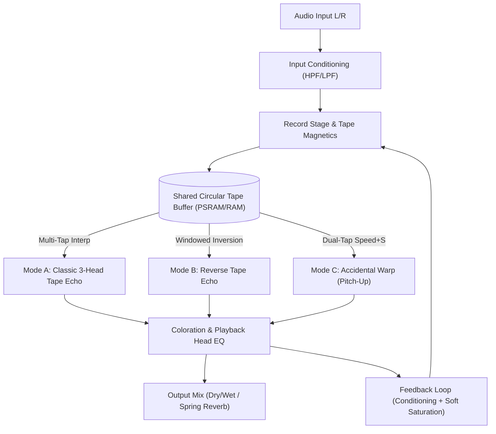

# HYDRA TAPE ENGINE 2.0 — PRODUCT VISION

## 1. Missão Executiva & Filosofia do Instrumento

O **Hydra Tape Engine 2.0** é um instrumento de manipulação temporal e espacial inspirado no comportamento eletromecânico de gravadores de fita analógicos (reel-to-reel e fita magnética multi-cabeça), estendido com processamento granular e transposição temporal assimétrica.

O Hydra não foi projetado para ser apenas um simulador acadêmico ou clone previsível de ecos clássicos de fita (como Roland Space Echo RE-201, Watkins Copicat ou Maestro Echoplex). Sua identidade é fundamentada na união entre:
1. **A física orgânica e imperfeita da fita:** saturação por histerese magnética com circuito de polarização (bias), rolloff não linear de altas frequências por gap loss, ressonância mecânica nas baixas frequências (head bump), instabilidade contínua de transporte (wow, flutter e scrape flutter) e ruído ponderado (hiss dinâmico com auto-ducking e dropouts aleatórios de óxido).
2. **A manipulação experimental radical:** leitura reversa temporal janelada com dispersão difusa e o modo proprietário **Accidental Warp** — um processador granular-temporal não estandardizado que gera cascatas harmônicas ascendentes com rítmica própria e transposição acidental.

> **Princípio Central:** Preservar a sonoridade acidental, imperfeita e expressiva do Warp. O Hydra não busca ser um pitch shifter estéril ou cirurgicamente limpo; o charme acústico reside nos artefatos transitórios, nas dobras de fase, na textura rítmica granular e no comportamento de feedback em espiral que transforma ecos em texturas orquestrais e fantasmas harmônicos.

---

## 2. Plataformas Alvo & Arquitetura de Portabilidade

O núcleo de processamento do Hydra 2.0 é escrito em **C++17 estrito**, mantido com zero dependências externas na camada DSP central (`dsp/core/tape_core.cpp`), garantindo compilação unificada para três ambientes prioritários:

| Plataforma | Hardware / Runtime | Frequência de Amostragem | Restrições & Características |
| :--- | :--- | :--- | :--- |
| **ESP32-S3 N16R8** *(Prioridade 1)* | Microcontrolador Dual-Core Xtensa LX7 @ 240 MHz, 16 MB Flash Quad, 8 MB Octal PSRAM (OPI) | 44.1 kHz (Firmware I2S DMA) | Alocação de delay em PSRAM via `heap_caps_malloc(MALLOC_CAP_SPIRAM)`. Filtros e estados críticos em SRAM interna. Zero alocação dinâmica no callback de áudio. |
| **C++ Nativo / Desktop** | x86_64 / ARM64 (Linux, macOS, Windows) | 44.1 kHz / 48 kHz / 96 kHz | Golden tests de regressão determinísticos, testes de estresse de longa duração, suites CI automatizadas. |
| **WebAssembly / Web Audio** | AudioWorklet ES6, compilado com Emscripten (`BUILD_WEB=ON`) | 48 kHz (ou taxa nativa do navegador) | Renderização em tempo real na interface web, interoperabilidade estrita semântica de parâmetros via AudioParam e MessagePort. |

---

## 3. Territórios Sonoros & Modos Principais

O motor unificado opera sobre uma linha de retardo magnética circular contínua, suportando três modos de operação fundamentais:

### 3.1. Mode A — Classic Three-Head Tape Echo
Preserva e desenvolve o delay rítmico clássico de fita com três cabeças de reprodução independentes:
- **Cabeça 1 (Lead / Slap):** Subdivisão rápida (ex: 1/3 do atraso base ou tercina rítmica).
- **Cabeça 2 (Body / Groove):** Subdivisão intermediária (ex: 2/3 do atraso base ou colcheia pontuada).
- **Cabeça 3 (Anchor / Main):** Tempo base completo.
- **Controle Matricial:** Ativação independente por máscara de bits (`activeHeads = 1..7`), ganho relativo compensado e controle de modo rítmico (`headsMusical` sincronizado ao andamento global).
- **Degradação Progressiva de Feedback:** Cada volta no laço aplica atenuação de altas frequências (`feedbackGapLoss`), ressonância mecânica (`feedbackHeadBump`) e dupla saturação magnética assimétrica suave (`fastSatRational`).

### 3.2. Mode B — Reverse Tape Echo
Reconstrução cirúrgica da leitura reversa sobre o buffer compartilhado:
- **Janelamento Temporal Duplo:** Leitores reversos defasados em crossfade suave para eliminar estalos e transientes bruscos de borda.
- **Inversão Temporal Real:** A taxa de varredura relativa ao ponteiro de gravação caminha no sentido negativo dentro de cada ciclo de grão, invertendo transientes (ataques lentos de swell).
- **Fase Estéreo Coerente:** Varredura sincronizada entre canais esquerdo e direito, com opção de difusão por rede allpass (`reverseSmear`).
- **Sincronia Rítmica:** Comprimento da janela reversa sincronizado a frações do BPM do transporte.

### 3.3. Mode C — Accidental Warp
O diferencial vanguardista do Hydra. Uma estratégia granular de avanço assimétrico que gera **transposição tonal exclusivamente ASCENDENTE**:
- **Dual-Tap Crossfade Complementar:** Dois pontos de leitura virtuais defasados em 180° com envoltórias triangulares complementares cuja soma é unitária ($G_1 + G_2 = 1.0$).
- **Velocidade Efetiva:** $v_{eff} \approx 1 + \text{speedMultiplier}$, acelerando a leitura sobre a fita e transpondo o sinal para oitavas e intervalos harmônicos superiores (uníssono, quinta justa, oitava superior, etc.).
- **Feedback em Espiral:** O sinal lido em velocidade acelerada retorna à cabeça de gravação magnética, produzindo repetições que sobem continuamente de tom a cada iteração (cascata infinita de oitavas e arpejos cósmicos).

---

## 4. Evoluções Criativas do Warp (Roadmap de Expressividade)

O roadmap do Hydra 2.0 estabelece 6 evoluções conceituais do ecossistema Warp:

1. **Warp Head Híbrida:** Conversão dinâmica de uma das três cabeças do tape echo em cabeça Warp (ex: Cabeças 1 e 2 em Forward tradicional fornecendo sustentação e ritmo, enquanto a Cabeça 3 opera como Warp ascendente).
2. **Warp Character (Macro Textura):**
   - *Smooth:* Interpolação cúbica Hermite4 de alta fidelidade e janelamento Hann suave.
   - *Grainy:* Janelas triangulares acentuadas, com modulação percussiva evidente na frequência dos grãos.
   - *Broken:* Leitura crua com quantização inteira de ponteiros e descontinuidades analógicas/digitais intencionais.
3. **Spiral Feedback:** Controle contínuo de rota do laço de realimentação, dosando a fração de sinal seco da fita versus o sinal granular transposto que retorna à cabeça de gravação.
4. **Rhythmic Warp:** Sincronização estrita da taxa de repetição e transição dos grãos com a grade de tempo do sistema (1/4, 1/8, 1/8T, 1/8D, 1/16).
5. **Stereo Orbit:** Espacialização dinâmica através do desacoplamento de fase granular entre os canais L e R ($\Delta \phi = 0.25 \times \text{stereoWarp}$), gerando movimento estéreo tridimensional sem perdas de compatibilidade mono.
6. **Hold / Infinite Freeze:** Congelamento instantâneo da fatia de áudio corrente no buffer de fita com interrupção da gravação e manutenção contínua da recombinação granular Warp.

---

## 5. Catálogo de Presets de Referência

| Preset | Modo Base | Caráter / Aplicação |
| :--- | :--- | :--- |
| **01. Classic Three-Head** | Tape Forward | Eco espacial estilo fita clássica, 3 cabeças rítmicas ativas, wow/flutter moderado, saturação quente. |
| **02. Dub Echo** | Tape Forward | Feedback elevado próximo à auto-oscilação, rolloff escuro de agudos, compressão magnética profunda. |
| **03. Reverse Swell** | Reverse Echo | Repetições 100% invertidas, smear ativado, transientes desvanecidos, ambiência cinematográfica. |
| **04. Accidental Warp** | Warp V1 | Multiplicador de velocidade $1.0\times$ (+1 oitava acima), grãos de 80 ms, realimentação em cascata ascendente. |
| **05. Ascending Ghosts** | Warp V1 | Grãos médios (120 ms), multiplicador $0.5\times$ (+7 semitons), feedback filtrado progressivo. |
| **06. Grainy Orbit** | Warp V1 | Abertura estéreo máxima (`stereoWarp = 1.0`), grãos curtos (35 ms), efeito percussivo granular. |
| **07. Broken Tape** | Tape / Warp | Leitura sem interpolação, dropouts severos, instabilidade mecânica extrema, colapso de fita gasta. |
| **08. Rhythmic Stutter** | Warp V1 | Grãos de 50 ms sincronizados com tap tempo, feedback moderado, ecos fatiados rítmicos. |
| **09. Spiral Feedback** | Warp V1 | Realimentação circular de alto ganho com saturação de duplo estágio e controle anti-runaway. |
| **10. Frozen Fragments** | Tape / Warp | Buffer congelado (`freeze = true`), manipulação granular estática contínua sobre textura retida. |

---

## 6. Matriz de Funcionalidades do Produto

| Funcionalidade | Estado Atual | Versão Alvo | Descrição / Observações |
| :--- | :--- | :--- | :--- |
| Motor Central TapeCore Consolidado | **Implementado** | v1.2 | Unificação de TapeModel em TapeCore com zero alocação no loop. |
| Modelo Magnético & Histerese (LUT) | **Implementado** | v1.2 | Saturação por tabela tangente hiperbólica com bias HF e remanência. |
| Modelo Mecânico (Wow/Flutter/Scrape) | **Implementado** | v1.2 | Ruído rosa, LCG filtrado e modulação física acoplada à velocidade. |
| Reverb de Mola Físico (Spring Reverb) | **Implementado** | v1.2 | Rede de 6 allpass + filtros passa-baixas em cascata estéreo. |
| Modo Accidental Warp V1 Dual-Tap | **Implementado** | v1.3 | Leitura dupla defasada em 180°, transposição ascendente, Hermite4. |
| Controle de Stereo Warp | **Implementado** | v1.3 | Deslocamento de fase temporal granular entre canais esquerdo e direito. |
| Leitura 1-Tap Crua (Bug de Laboratório)| **Implementado** | v1.3 | Modo selecionável para testes A/B comparativos com o protótipo Web. |
| Reversão Janelada Aprimorada (Mode B) | *Planejado* | v1.4 | Correção formal de direção de varredura estéreo e crossfade senoidal. |
| Tap Tempo Compartilhado & Slew/Clean | *Planejado* | v1.5 | Módulo de transporte rítmico com interpolação de delay suave. |
| Warp Head Híbrida (Cabeça C = Warp) | *Planejado* | v2.0 | Integração da leitura granular como terceira cabeça do tape delay. |
| Macro Warp Character (Smooth/Grain/Broken)| *Planejado* | v2.0 | Interpolação contínua entre algoritmos de leitura e janelamento. |
| Hold / Release Granular | *Planejado* | v2.0 | Captura sem estalo do loop de fita e liberação assintótica. |
