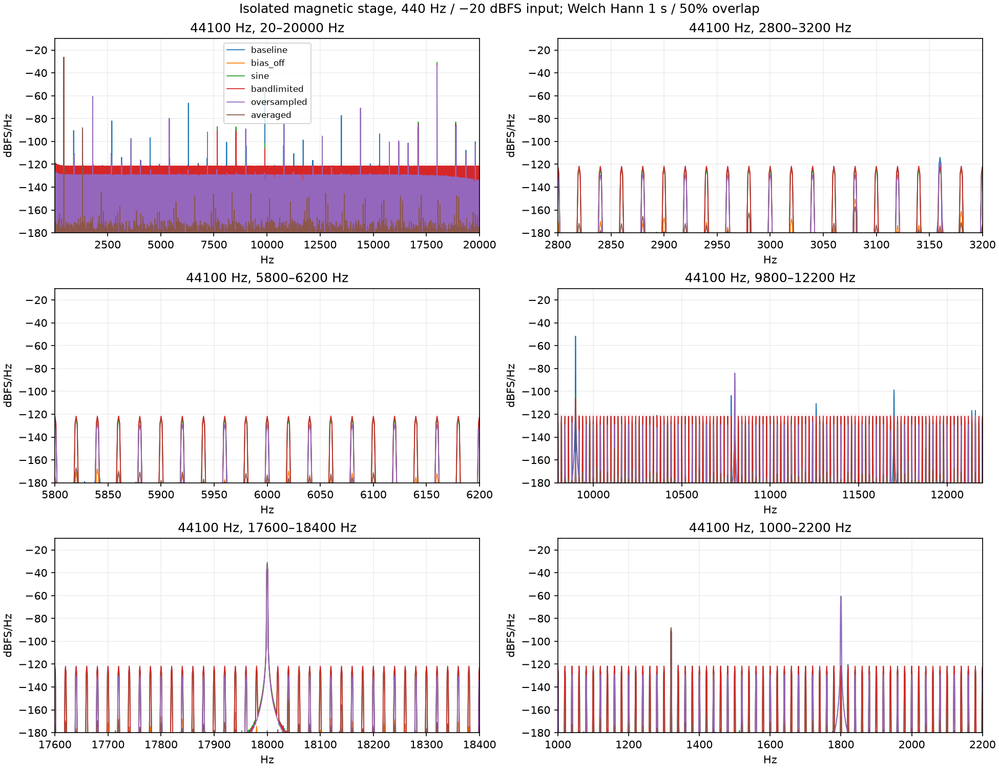
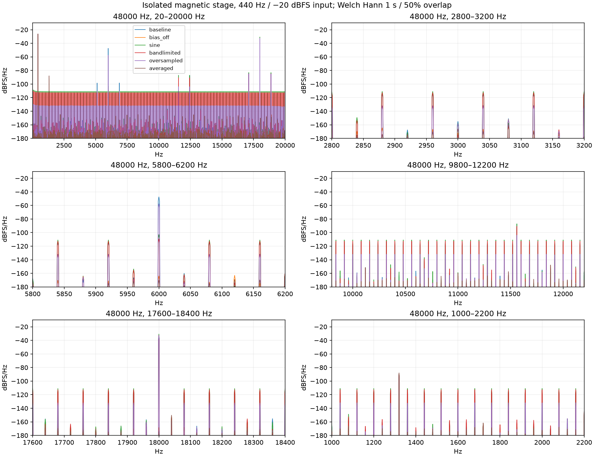
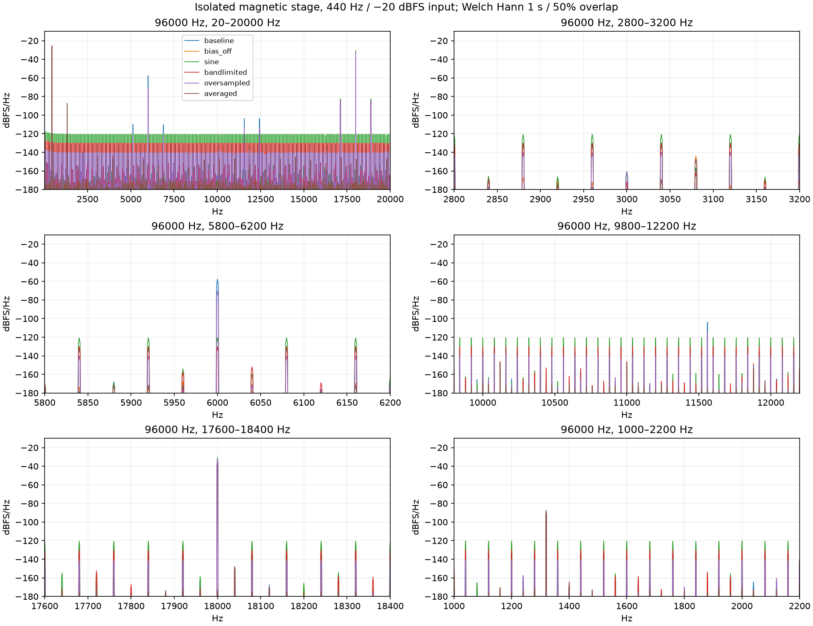
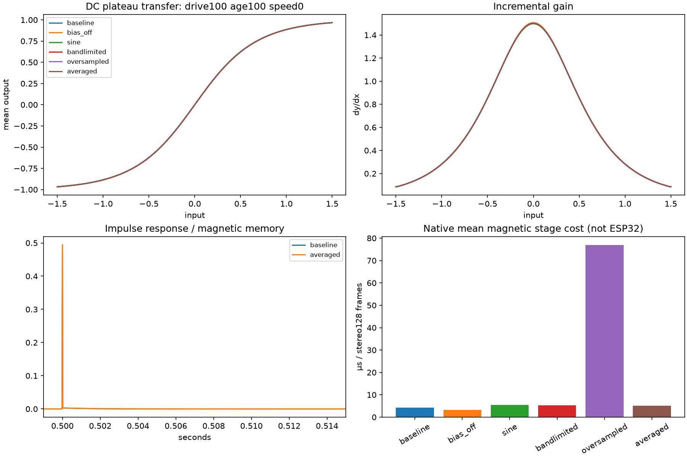
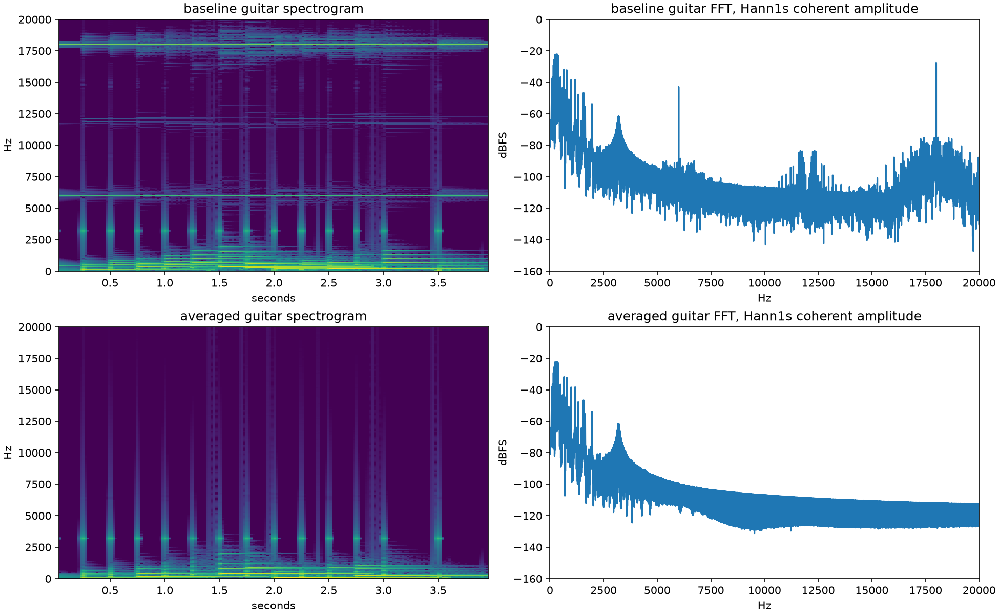
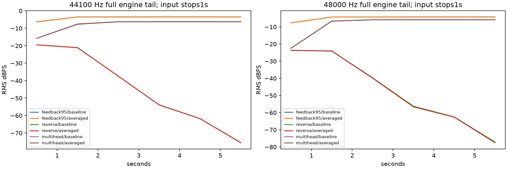

# Phase 6.2 — bias anti-aliasing and magnetic character

Date: 2026-11-19. Existing PR: [#54](https://github.com/ovelhaaa/hydra-tape-engine/pull/54). Branch: `feature/musical-validation-phase6`; destination: `main`. Audited/fetched baseline: `fa43cdefff22059b55adf3d2202a19f2571cf9d3`; no intervening remote commits at initial fetch. Existing untracked `scripts/create_phase6_pr.py` was preserved and excluded.

**Candidate: phase-averaged magnetic bias. Phase 6.3 recovered the three Native regressions and removed the physical Reverse deadline failures without changing this DSP; residual release blockers are the complete-engine tail/transition criteria and issue #48. Candidate human audition: PASS (12/12, reviewed f0c16cd local package). See the [Phase 6.3 report](PHASE6_REVERSE_REALTIME_OPTIMIZATION.md). No merge, threshold changes or golden updates. Human approval scope is recorded below.** The A/B package is available for investigation even when CI is red. A reduction in whistles does not establish preservation of tape character.

## Human approval — 2026-11-19

The responsible user approved all 12 candidate listening scenarios in the f0c16cd local Windows package. All exported content hashes were verified; see the [human audition record](PHASE6_BIAS_HUMAN_AUDITION.md). Per-criterion scores were not supplied and are not inferred. Historical NOT REVIEWED statements below describe package publication or fresh render defaults. Human audition is cleared for this scope; technical regression/performance gates remain blocked.

## Physical and CI follow-up

[Verified board measurements, all six variants, restore evidence and actual CI artifacts](PHASE6_BIAS_HARDWARE_FOLLOWUP.md) supersede the initial unverified-physical-performance statements below. The selected algorithm is unchanged. Physical findings established a performance block that Phase 6.3 has since removed for the tested Reverse paths, with zero overruns over 10 000 blocks per scenario and a five-minute sustain; see the [Phase 6.3 report](PHASE6_REVERSE_REALTIME_OPTIMIZATION.md). Subsequent human approval is recorded above; no merge.

## Audit and reproduced cause

One bias generator exists, instantiated independently in left/right `TapeMagnetics`. Record path: input HPF/LPF → input drive plus feedback → DC blocker → clamp → magnetic nonlinearity → delay buffer → forward/reverse/head reads → dropout/azimuth/hiss → playback shelf/head bump/LPF → monitor limiter. Feedback branches before playback filtering and has its own HPF, LPF, phase, saturation and compression before returning to magnetics. Playback filtering cannot undo aliasing already written into the buffer or feedback.

At 48 kHz the 18 kHz triangle is sampled at only eight distinct phases. Its third harmonic at 54 kHz folds to 6 kHz; higher odd harmonics can reinforce the same bins. At 44.1 kHz, third/fifth/seventh harmonics fold to 9.9/1.8/6.3 kHz. The nonlinear stage additionally generates intermodulation; oscillator harmonic folding alone is not the complete explanation. `expected_aliases_hz` records odd harmonics through order15 for every tested rate.

Before any production change, `diagnose_bias_whine.py` reproduced scenario01 at **−49.02765/−49.17738 dBFS** in 5990–6010 Hz. The control WAV was byte-identical to the preserved Phase6.1 local reference. The original20-scenario audio was not overwritten. A frozen diagnostic-only `dsp/diagnostics/tape_bias_baseline.inc` now preserves the triangular model; production never includes this file.

Sample rate sets bias frequency, gain-ramp samples and playback coefficients. Original magnetic remanence is per sample, so its physical time constant differs with sample rate; this was preserved rather than silently redesigning dynamics. Drive, age and speed retain their original mappings. The model has a remanent leaky state and positive coercivity feedback; no claim of a validated physical hysteresis loop is made.

## Experiments and selection

All six models were built into separate libraries from copied sources while production remained unchanged. A: original triangle. B: zero bias, ablation only. C: unit sine18k. D: Fourier fundamental `8/pi²*cos(phase)`; at both target rates no higher triangular harmonic fits below Nyquist. This is a band-limited representation, not a faithful full triangle. E: local2× stage with explicit49-tap Kaiser(beta9) interpolation/decimation filters, cutoff0.46 of high-rate Nyquist, original carrier retained, remanence adjusted by square root and gain ramp by1/2. This introduces24 base-rate frames of latency and extra filter states. It does not oversample the full engine.

The2× experiment rejects some harmonics but the triangle still has harmonics above its high-rate Nyquist. For example90 kHz folds to6 kHz at96 kHz before decimation. Its expensive direct FIR implementation is a diagnostic prototype, not an optimized ESP32 implementation.4× was not pursued: F already met the spectral/transfer criteria with lower complexity and no filter delay;2× results do not prove that all possible oversampling designs fail.

F averages the nonlinear effect of the bias, retaining the existing field `h=x*drive+coercivity*m`, remanence, state update, gain ramp, saturation LUT and normalization:

```text
b = biasAmount * biasGain
y ≈ [LUT(h − b/√3) + LUT(h + b/√3)] / 2
m = remanence*m + (1−remanence)*y
output = satNorm*(0.82*y + 0.18*m)
```

A continuous triangular carrier has a uniform amplitude distribution on[-b,b]. Two-point Gauss–Legendre quadrature preserves its first three polynomial moments, including variance b²/3, without injecting a sampled carrier. See [NIST quadrature](https://dlmf.nist.gov/3.5). This is an averaging approximation to this existing model, not proof of equivalence to a physical tape recorder. The [DAFx physical tape-model paper](https://www.dafx.de/paper-archive/2019/DAFx2019_paper_3.pdf) describes a more detailed hysteresis approach; Hydra is not that model.

Frozen-field comparison against64-point quadrature of the same LUT,16001 field values[-4,4], gives maximum error6.06e-6 at b=.105, while bias-off differs from that reference by up to.001415. F therefore retains a measurable bias-dependent transfer effect. Phase-correlated ripple and carrier/audio intermodulation are deliberately absent; their musical impact still requires listening. At48 kHz the original discrete triangle variance differs from the continuous distribution, so exact waveform matching is neither claimed nor expected.

The objective comparison below was presented before applying F to production. Selection weights: whistle suppression, magnetic character and embedded cost very high; Native/WASM, latency and feedback high; simplicity/maintenance medium. A retains the known defect. B has low cost but removes the bias effect. C/D retain the carrier and nonlinear products. E is expensive, delayed and incompletely suppresses aliases. F gives the strongest relevant suppression while retaining the mean nonlinear effect, no added buffer, no added latency and two LUT evaluations instead of one. It is a **candidate**, not an approved final sound.

## Methods and prospective limits

13 stimuli per rate: digital silence,110/440/1000/5000Hz sines,440+1000Hz two-tone, impulse, lowpass-filtered noise, clean/driven guitar, mono/poly synth and drum machine. Rates44.1/48/96kHz;96kHz is offline diagnostic only. Same inputs and seeds per variant; no version-specific gain normalization. Isolated stage spectra separate magnetic behavior from playback filtering; full-engine checks separately retain hiss, feedback, Reverse and Multi-Head.

Stationary metrics use seconds1–4, Welch periodic Hann windows of1s,50% overlap,1Hz bins. Band metrics integrate ±10Hz around each reported center. THD sums ±3Hz bands at harmonics; THD+N integrates20–20000Hz excluding the fundamental ±3Hz, referenced to fundamental RMS. Nonharmonic power also excludes all in-band harmonic bands. This includes LUT residuals and avoids calling musical harmonics aliasing. IMD product levels are absolute dBFS at120,560,1440,1560,1880,2440Hz; they are not a standardized SMPTE/DIN IMD percentage. Musical spectral peaks are observations, not automatically classified artifacts.

Limits fixed in `bias_antialiasing.LIMITS` before initial measurements: ≥40dB reduction of48kHz6kHz line; isolated440Hz nominal/high-drive nonharmonic power <−80dBFS across20–20000Hz; silence peak≤1e-7; lowband(<3kHz) gain/crest changes≤.5dB; transfer output difference≤.003 and slope difference≤.02; full-engine peak≤1; event-window step≤.03. Determinism is exact. Full-engine tail gate requires last-second RMS≤third-second RMS. None was relaxed after observing failures.

Transfer uses151 DC plateaus[-1.5,1.5], fresh state per plateau,1s each, mean over last.5s at48kHz, across three drive/age/speed combinations. Symmetry, slope and output curves are retained. This measures equilibrium transfer, not hysteresis. Impulse and musical transients are saved separately. Full-engine tail scenarios last6s with input silenced after1s; they do not establish sustained physical stability.

## Regression findings and unresolved gates

**Phase 6.3 update:** the three Native failures described in this section were assertions that measured the removed triangular carrier. They are recovered without restoring the carrier; the full Native suite is now 15/15. The Reverse deadline failures are also removed (zero overruns, 10 000 blocks × 9 scenarios + 5-minute sustain). The strict Native/WASM numbers and the four complete-engine tail criteria below remain unchanged and are explicit blockers. See the [Phase 6.3 report](PHASE6_REVERSE_REALTIME_OPTIMIZATION.md).

Isolated criteria:49/49 passed at44.1/48/96kHz. Full-engine criteria:22/27 passed. Four strict tail-growth gates failed: feedback95 and Multi-Head at both target rates show small sustained RMS increases, also present in baseline. The largest candidate change over the tested interval is.03772dB. Both engines can sustain nonlinear feedback rather than decay. Peak remains bounded below1 in these tests; this does not convert the failed tail criteria to PASS.

The44.1kHz parameter-event gate failed with maximum step.05122 against.03. Baseline comparisons are included in engine evidence; existing parameter/filter transitions may contribute. No unrelated parameter smoothing or feedback code was changed to hide this. Further investigation is required before declaring click-free operation.

Native CTest:12/15. Failures: `core_warp_test`, `core_reverse_test`, `core_transition_characterization`. Isolated matched baseline passes all three; candidate fails. Detailed diagnostic source copies show:

* Near-threshold input6e-7 formerly generated carrier peak.0028086. Carrier-free output6.70577e-7 fails the existing lower-bound requirement>1e-6; scalar/block/reset/channel checks before that assertion still pass.
* Reverse ping-pong1s test expects right energy>.001 before a full second return. BaselineR energy.0126841 includes carrier; candidate5.87901e-6. Separate3s observation with the same energy threshold passes in both models; candidateR energy.0319015. This observation does not replace the original failing test.
* Several transition windows miss real reversed markers in both models. Baseline bias floor~.0116 satisfies the test; F exposes the missing marker. Actual peak times1.7494375/2.2494375/3.8994375s match exactly; peak amplitudes differ about.02%. These are strong indications of carrier-dependent assertions, not authority to change them.

Official assertions, thresholds, scenarios and goldens remain unchanged. Correcting their measurement windows or carrier-presence assumption requires explicit technical review; CI remains red. No Reverse algorithm change was made.

All three Native goldens and three WASM goldens passed. Complete local WASM CTest11/15: magnetic warp/reverse assertions plus strict equivalence/A/B comparison fail. ABI legacy consumer and symbols pass; C1.7 headers/layouts/IDs/presets are unchanged. GTC, Tap Tempo and MIDI Clock tests pass. No golden revision is currently needed or authorized.

Matched WindowsMinGW/Emscripten local comparison: baseline max_abs5.968e-6/RMSE2.344106157418e-6; candidate max_abs7.659e-6/RMSE2.473002165970e-6. Both fail the unchanged RMSE≤1e-6 threshold; max_abs≤1e-5 passes. Additional scalar RMSE is1.28896e-7(+5.5%); error-vector differenceRMS3.87743e-6, not a new acceptance tolerance. Historical LinuxCI baseline3.6681e-5/1.585565032192e-5 is a separate environment. Issue[#48](https://github.com/ovelhaaa/hydra-tape-engine/issues/48) remains open.

## Performance and realtime limits

ESP32-S3 firmware builds successfully with local PlatformIO6.2 tooling, Xtensa14.2,240MHz configuration: static RAM25920/327680bytes; flash618463/16777216bytes. These are link sizes, not heap/stack/PSRAM runtime measurements. Python3.14's alternate PIO installation was unsupported; the existing `C:/.platformio/penv` installation completed the build.

Native benchmarks below cover3000 measured blocks after100 warmup, stereo128frames, every variant. Magnetic timing is C++chrono; total-engine timing surrounds the CAPI call and includes ctypes overhead. OS scheduling and benchmark order affect results. These values do not prove ESP32 deadline compliance or a speedup. Before the follow-up linked above, no fresh physical firmware run, I2S-failure measurement, allocation instrumentation, heap, PSRAM or stack measurement had been performed. Serial ports being enumerated is not runtime evidence. Required board P99<~2032µs, zerooverruns/I2Sfailures and memory measurements remain pending.

Production changes only the magnetic evaluation: one extra LUT call, fixed scalar state, no new dynamic allocation, lock, buffer or latency. The existing callback allocation/concurrency design is unchanged; absence of newly added allocation is a source audit, not an instrumented zero-allocation proof.2× diagnostic uses fixed FIR state; no global oversampling was implemented.

## Reproduce, listen and distribute

```sh
cmake -S . -B build-native -DCMAKE_BUILD_TYPE=Release -DBUILD_TESTING=ON
cmake --build build-native -j
python scripts/bias_antialiasing.py --compiler g++
python scripts/validate_bias_engine.py
python scripts/plot_bias_antialiasing.py
python scripts/diagnose_bias_regressions.py
python scripts/package_bias_ab.py --archive artifacts/hydra-phase6-bias-ab.zip
```

The complete-engine command intentionally returns nonzero for the recorded failed criteria. Continue to evidence/packaging separately; do not interpret shell short-circuiting as all checks having run. `diagnose_bias_regressions.py` preserves original assertions; its separate3s copy is an observation only. Emscripten on PATH enables its matched baseline/candidate numerical comparison. On Windows the compiler defaults to the CMakecache compiler; use a supported Python for PlatformIO.

The existing Listening Lab now accepts the explicitly named60-pair supplement while retaining the original20-scenario schema.12 priority scenarios compare baselineA against each ofB–F:120 PCM24stereoWAVs,60telemetryCSVs, SHA256 manifest, provenance, guide and existing player. A/Original is **baseline processed output**, B/Processed is **variant processed output**; no independent loudness compensation. Only A/B content changes; there is no new interface. Package sample rate48kHz,6s per pair, same source/BPM/events/seeds/parameters within every pair. Raw stimuli hashes are recorded.

Human states started as `NOT REVIEWED`; the responsible reviewer then approved all 12 candidate scenarios and exported the JSON recorded above. No approval is inferred from metrics. See [bias A/B guide](PHASE6_BIAS_AB_LISTENING_GUIDE.md). The standalone `bias-antialiasing.yml` builds all variants, checks spectra/full engine, runs Native/WASM/ESP32build gates, validates and uploads review files even if technical gates fail, then explicitly fails its final gate. Existing Phase6 workflows remain present. Actual artifact links and final source HEAD are recorded in PR#54 after upload; no link is invented in advance.

## Measured tables and figures

Machine-readable results: [isolated stage](evidence/phase6-bias-antialiasing.json), [complete engine](evidence/phase6-bias-engine.json), [regression diagnosis](evidence/phase6-bias-regressions.json). Source hashes identify precommit local experiments; these are dirty-worktree measurements, not a falsely claimed final-commit build. CI regenerates provenance from the pushed HEAD. Compiler commands have machine-specific repository/compiler roots sanitized in committed evidence.

<!-- GENERATED_MEASUREMENTS -->

| Variant | Stage6k @48k dBFS | Stage18k @48k dBFS | Nonharmonic @44.1k dBFS | Native magnetic mean/P99 µs |
|---|---:|---:|---:|---:|
| baseline | -45.71 | -30.38 | -30.77 | 4.04/5.10 |
| bias_off | -162.24 | -166.80 | -136.31 | 3.18/3.30 |
| sine | -101.14 | -29.01 | -29.01 | 5.15/5.30 |
| bandlimited | -107.38 | -30.83 | -30.83 | 5.16/5.30 |
| oversampled | -55.93 | -30.82 | -31.68 | 69.60/86.30 |
| averaged | -168.20 | -172.61 | -137.16 | 4.82/4.90 |

These isolated-stage values include no playback attenuation and are not directly comparable to the scenario01 full-engine values.

| Rate | F nominal nonharmonic dBFS | F high-drive nonharmonic dBFS | Max musical lowband gain difference dB |
|---|---:|---:|---:|
| 44100 | -137.16 | -129.88 | 0.000285 |
| 48000 | -138.87 | -130.17 | 0.001474 |
| 96000 | -146.15 | -133.21 | 0.000308 |

| Variant | Complete engine44.1k mean/P95/P99/peak µs | Complete engine48k mean/P95/P99/peak µs |
|---|---:|---:|
| baseline | 24.94/25.50/31.10/47.70 | 24.65/25.10/26.80/49.70 |
| bias_off | 24.74/25.60/31.40/51.30 | 23.84/24.50/26.00/52.10 |
| sine | 27.24/27.70/33.70/43.60 | 26.34/26.90/28.30/51.40 |
| bandlimited | 27.14/27.70/33.70/71.70 | 26.20/26.70/28.10/54.20 |
| oversampled | 90.05/96.10/102.00/126.50 | 90.75/93.80/107.20/141.80 |
| averaged | 25.32/26.10/32.70/58.90 | 24.62/25.30/26.60/42.50 |

Native deadline-exceedance counts were zero in these short host benchmarks. See the physical follow-up for measured board overruns and I2S write-failure counts; stack/allocation counts remain unmeasured.

The event-window step at44.1k was0.08783 baseline versus0.05122 F (speed change); both exceed0.03. At48k F maximum0.02540 meets this limited event test.












