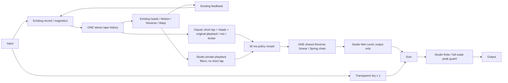

# Signal path architecture

Status: experimental; `HUMAN_LISTENING_PENDING`. Default remains CLASSIC (0).

## Endpoints

CLASSIC keeps every original mix and limiter formula. STUDIO (1) uses the same
magnetic history, normalized head reads, Motion M0/M1/M2/M3, Reverse, Warp and
feedback. A small private playback chain receives only `delaySig * delayGain`,
plus the existing tape hiss, then the same dropout/azimuth/head EQ coefficients.
The short 200-sample texture head stays in Classic monitoring and never enters
Studio monitoring. No extra texture switch is needed: Classic is Vintage Texture,
Studio is Clean Dry. The original recording and feedback paths remain untouched.
This also preserves legacy A feedback topology when that build is selected.



The diagram describes Studio's endpoint; Classic's endpoint bypasses the new
post-auxiliary sum and guard and retains its original full-mix auxiliary routing.

## Transition contract and deliberate compromise

Let b slew in [0,1] at 1/(0.030*sampleRate) per sample. Each channel computes:

```
classic = original outputLimiter(input * dryGain + classicTapeOutput)
auxInput = classic + b * (studioTapeOutput - classic)
auxOutput = existing smear/spring processing(auxInput)
trim = 1 + b * (smoothedStudioWetLevel/100 - 1)
out = auxOutput * trim + b * input
```

At b=0 the existing final output is returned directly, without new floating-point
operations or protection changing its samples. At b>0 the final sum has a finite
check and a clamp to [-1,1]. At b=1 the dry enters after every wet effect.
Wet Level uses a finite linear slew of up to 30 ms over the full 0..200% range;
none of these changes call reset, change read positions, or change Motion Mode.

This morphs already available signals into one shared auxiliary chain. It is
**not** an exact crossfade of two independently running complete output chains:
nonlinear limiting and the existing auxiliary memory make those operations
non-commutative. The benefit is no duplicate Spring/Smear delay memory or CPU.
Their existing tails continue while excitation changes smoothly. The two small
playback EQ states stay warm continuously so monitoring switches do not restart
filters. Tests cover tails, sustained input, strong dry attacks, high feedback,
Freeze, Reverse, Spring, rapid switching and both 44.1/48 kHz dry contracts.
Human audition must approve the shared auxiliary-tail compromise.

## Parameters and compatibility

API 1.9.0 appends IDs 47=signalPathMode (0/1), 48=studioWetLevel (0..200%,
default 100%). IDs 0..46, all legacy C structures and exported symbols remain.
Use the parameter API for the two new controls; no legacy structure grows.
Existing set-params calls do not reinterpret the new parameter API state.
Preset schema remains v2 because its parameter map is extensible. UI import
actively restores Classic and Wet Level=100 when an old sparse preset lacks
these fields. New presets store both. Reusing an AudioWorklet/WASM instance is
verified by browser constructor instrumentation and C-API acknowledgements.

The old dryWet meaning remains Classic Texture Blend; it is hidden in Studio.
delayWet still means the historical head playback gain, while Studio Wet Level
is a final trim including Spring/Smear and hiss. Neither new control touches
feedback. Firmware's existing bulk parameter structure remains unchanged; the
new IDs are available through its existing queued parameter adapter.

Historical A/B packagers now reject major ABI differences rather than additive
minor versions. Existing frozen-header consumer and symbol tests still run.
