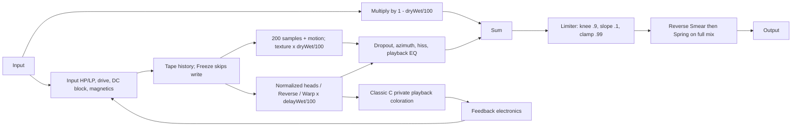

# Studio signal path audit — reference before implementation

Reference: PR #61, 503688c; stabilization follow-up c1f996b (explicit-reset
control-state initialization only). Audit recorded before 7.5A DSP changes.
Inspection: tape_core.cpp/.hpp, hydra_dsp_c_api.cpp, hydra_dsp.h,
main.js, hydra-processor.js, presetSerialization.js, src/main.cpp.

1. Direct input is unfiltered before the sum, but multiplied by 1-dryWet/100.
At dryWet=50 it is -6.0206 dB; at 100 it vanishes. It then shares output
limiting, optional smear allpasses and Spring with tape playback.
2. Limiter is identity within +/-0.9. Outside: .9 + .1*(abs(x)-.9),
with sign restored, then clamp +/-0.99. This compresses peaks before full
scale; it is memoryless, not a lookahead limiter. Spring limits a second time.
3. dryWet exchanges dry for short-head texture, not for delay repeats.
delayWet independently scales normalized repeat heads before playback EQ.
They are not a complementary dry/delay crossfade. Both at 100 is tape-only
texture plus repeats; both at zero is direct input through the output limiter,
plus injected playback hiss if noise is enabled. Firmware historically sets
both controls from p_mix; web exposes them independently.
4. The short tap is 4.535 ms at 44.1 kHz, 4.167 ms at 48 kHz. Correlated dry
and tap create approximate comb spacing fs/200 (220.5/240 Hz). Filters,
magnetics and motion change notch depth and positions. It remains audible
with delayActive=false. Warp suppresses this tap.
5. Strong dry attacks above .9 are compressed even with both wet gains zero;
absolute gain is not unity near full scale. Saturation in record/feedback
additionally shapes the wet, not the direct branch before summing.
6. Energy depends on correlation, head selection, filters and combined gains;
there is no constant-energy contract or equal-power law. Multihead weights
1/.75/.55 are normalized by their active sum; playback resonances can add gain.
7. Finite ordinary output samples are capped at .99 by the legacy limiter,
but post-limiter smear allpasses can overshoot. No independent master guard
follows smear when Spring is off. Sample limiting is not a true-peak guarantee.
8. Freeze skips magnetic writes but advances transport/read position; direct
input remains present. Reverse changes read windows and smooths mix/feedback;
legacy Reverse Smear acts on the full sum. Warp selects granular reads and its
own feedback. Spring processes the entire limited mix, with private feedback
and a second limiter. These are obstacles to transparent dry if reused as-is.
9. Legacy direct is unity only at dryWet=0, below limiter knee, no post-sum
processing, with tape/hiss absent. Studio needs its dry added after wet effects.
10. Keep IDs 0..46 and all legacy C structures/symbols intact. Append IDs;
old web presets must actively restore Classic even after Studio was selected.
Legacy setters have no new fields. Existing motion controls use parameter API.

Integration state at audit: Phase 6 lab passed on 503688c. Web Demo and
Unified Motion failed the same Stereo Motion=0 WASM assertion. Follow-up
c1f996b fixes reset initialization and passes that test with fresh WASM locally;
remote gates must still be observed. No merge, promotion, or hardware flash.
